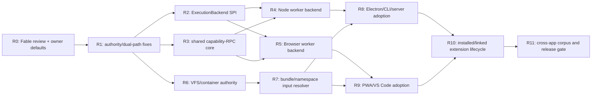

# ModkitX3 — следующий план A‑2/A‑3 после G‑APP‑1

Дата: 2026-08-18  
Базовая ветка: `spec/mk3-extension-reference`  
Проверенная база: `e92c2b1`
Runtime-коммиты: `ad6f0cc`, `f510b3b`, `84cdd1c`

Независимый review: `REVIEW_FABLE_NEXT_A2_A3_2026-08-18.md` — `REVISE`, P0 нет, семь P1
приняты в этот план.

## 0. Назначение и границы

Это не новая общая архитектура. План подчинён owner-документам `modkitx/docs/architecture/`,
MK3/23, MK3/24, MK3/27 и зафиксированным ABI ModkitX3. Он продолжает один ограниченный маршрут:

```text
extension inventory
  → openSubject
  → execution backend
  → leased session/data sources
  → presentation plan
  → application adapter
```

G‑APP‑1 уже закрыт для bundled Electron-кодеков через честный `trusted-node` путь. Следующая цель —
сделать `worker-brokered` реальным доступным execution profile, затем провести через тот же путь
контейнеры, составные assets и остальные приложения.

Не входит в этот план:

- обещание SB‑2 sandbox или защита worker от ambient Node/Web API;
- новый renderer, ECS, Multiverse runtime или массовый перенос MK2-кодеков;
- отдельная параллельная модель inventory/resolver/session;
- silent fallback с `worker-brokered` на `trusted-in-process`;
- перенос credentials, raw facets или произвольных request values в lock/IPC;
- изменение owner-документов без отдельного решения владельца.

## 1. Проверенная исходная точка

На `74b7976`:

- `packages/host/src/subject-open.ts` собирает inventory → bounded probe → resolver/lock →
  ticket/grant → activation → descriptor/session;
- `packages/host/src/security/gate.ts` fail-closed и поддерживает только
  `trusted-in-process`;
- provenance `bundled/installed/linked` и отдельное `allowTrustedInProcess` уже участвуют в gate;
- portable и trusted variants имеют непересекающиеся targets;
- Electron main владеет источником, codec session и data-source leases; renderer получает только
  проверенные вызовы через preload;
- `packages/host/src/source-bridge.ts` безопасно мостит numeric VFS source в bigint runtime source;
- default `SubjectInputResolver` поддерживает только `originKind: single` без companions;
- `packages/vfs` пока содержит только минимальный `RandomAccessSource<number>`;
- PWA/VS Code/headless app matrix доказывает декларативную композицию, но не единый product-open
  runtime для каждого приложения.

Базовый gate: `pnpm check` — 66 test files / 476 tests, 14 schemas, 16 UI manifests и 16 app/realm
cases.

## 2. Неподвижные инварианты

Каждый последующий slice обязан сохранять:

1. Один публичный host-owned путь открытия subject: `openSubject` или его совместимый facade.
2. Resolution выбирает logical offer; activation backend исполняет выбранный execution profile.
3. Недоступный backend означает structured unresolved/rejection, а не понижение профиля.
4. Trusted execution разрешается только provenance + host policy, а не именем publisher/manifest.
5. Renderer/webview не импортирует codec/provider implementation.
6. Все объекты с lifecycle пересекают границу как leases/handles и освобождаются идемпотентно.
7. Bytes, iterators, events, errors, cancellation и budgets остаются bounded и fail-closed.
8. Lock содержит только canonical non-secret selection data.
9. Source revision и полный revision vector сохраняются через open/restore/cache boundaries.
10. Wire/schema authority не дублируется ради удобства транспорта.

## 3. Критический путь



Review R0 завершён с verdict `REVISE`. Production integration начинается с устранения найденных
двойных authority: method surface, capability-RPC, lock/selection, generated catalogs и legacy UI
codec path. Тестовые fixtures можно готовить параллельно в непересекающихся scopes.

## 4. Этап R0 — независимый review и owner decisions

### NXT-000 — зафиксировать baseline

- Считать `e92c2b1` проверенной точкой review (`74b7976` — проверенная runtime/docs база до плана).
- Воспроизводить `pnpm check`, Electron subject-services test и app matrix.
- Любая находка должна указывать exact file/contract и отличать production defect от owner-doc drift.

### NXT-001 — Fable review — завершено

Fable провёл read-only аудит. Результат сохранён в
`REVIEW_FABLE_NEXT_A2_A3_2026-08-18.md`:

- `ACCEPT`, `REVISE` или `BLOCK`;
- P0/P1/P2 findings с доказательством;
- предлагаемые перестановки NXT-задач;
- список owner decisions;
- один рекомендуемый bounded implementation slice для Fable;
- список безопасных параллельных задач для остальных агентов.

Verdict: `REVISE`; P0 нет. Приняты findings F‑01…F‑07 и patch-list NXT‑103…107.

### NXT-002 — обязательные owner decisions

До public ABI freeze нужно подтвердить:

1. Execution backend registry — internal host SPI, а не новый contribution contract.
2. Worker protocol — private versioned transport; SDK экспортирует только capability ABI.
3. Честное название границы: SB‑1 crash/cancellation/I/O brokerage, не sandbox.
4. Владелец bigint byte-source contract: `vfs` с SDK re-export либо сохранение checked bridge.
5. `common.vfs/mount@1` и `common.vfs/container@1`: service contracts или иной owner-approved seam.
6. Installed/linked provenance, digest policy и запрет trusted execution по умолчанию.
7. Data-source method surface — публичная contract-definition authority, а не app allowlist.
8. Probe-time activation — только с probe grant, cap кандидатов, явным universal-match и
   disposable/pooled worker lifecycle.
9. Codec detection selection не является provider-policy lock entry; это отдельная provenance
   запись.

Рабочие defaults D‑1…D‑9 принимаются по рекомендациям Fable до owner-promotion. Особенно:

- `vfs` владеет bigint byte/namespace source contract, SDK его реэкспортирует;
- `surface.methods` описывает `value | lease | iterable | events` и schemas args/returns;
- bundled trusted разрешён policy по умолчанию, installed требует явного host-side решения,
  linked разрешён только в dev с diagnostic;
- SB‑1 означает crash/cancellation isolation, brokered I/O и Node `resourceLimits`, но не sandbox.

### Exit R0

- Нет открытого P0.
- Для каждого P1 есть owner, решение/default и acceptance proof.
- План обновлён по review; production work распределён по непересекающимся file scopes.

## 5. Этап R1 — execution backend SPI

### NXT-100 — отделить policy gate от механизма исполнения

Статус: **завершено** 2026-08-18 (`88a957d`).

Ввести внутренний `ExecutionBackend`/`ExecutionBackendRegistry` в host:

- `profile`, поддерживаемые realms/targets и feature availability;
- `activate(validatedTicket, boundArtifact, grant, context)`;
- возврат leased module/session capability;
- structured diagnostic при unavailable/mismatched backend;
- current trusted import становится первым backend, без изменения его provenance checks.

`SUPPORTED_EXECUTION_PROFILES` перестаёт быть глобальной декларацией возможностей. Доступность
определяет конкретная host composition. Resolver не получает preference по profile.

Реализация сохраняет admission checks в activation gate, а импорт/worker/process mechanism
передаёт registry, созданному host composition. Registry fail-closed, захватывает callback identity
при создании, не принимает structural forgery и возвращает idempotent module lease. Текущий
`trusted-in-process` import является первым backend; Electron передаёт registry своего main realm в
единственный `openSubject` path.

### NXT-101 — связать resolution с backend availability

Статус: **частично завершено** (`88a957d` закрывает backend availability и lifecycle; signature
authority и отдельный probe grant остаются открыты).

- До выбора кандидата host знает, может ли target выполнить profile.
- Два variants одного contribution не должны становиться ambiguous для одного target.
- Backend не может заменить выбранный variant другим после ticket issuance.
- Ticket, digest, entrypoint и runtime variant остаются связаны до import/spawn.
- Probe использует отдельный grant, строго уже open grant, и только bounded source reads.
- Отсутствие match rules больше не означает universal match; universal codec декларирует это явно.
- Filename extension остаётся только candidate hint. Для renamed files host строит bounded
  data-only magic/signature candidate index из validated inventory; `.dat` PNG обязан доходить до
  PNG probe. Запускать все установленные кодеки для unknown source запрещено.
- Число probe candidates bounded; worker probes disposable или pooled с доказанной очисткой.
- Проигравшие candidates освобождают activation/module/worker resources и все host-issued provider
  leases до возврата результата. В текущем ABI у `Codec` нет `dispose`: NXT‑101 использует
  host-owned probe lease scope и worker termination; pre-open resource retention codec-ом
  запрещается conformance profile. Добавление lifecycle method требует отдельного owner-approved
  public ABI patch.

Уже доказано: disjoint trusted/portable variants не создают ambiguity; worker-only candidate на
`node-worker` получает structured rejection без backend, а после подключения backend тот же
resolver выбирает `portable`; probe failure, ambiguity, losing candidates и session disposal
освобождают backend/provider leases детерминированно и идемпотентно.

Открытая часть NXT-101B:

- заменить текущую ошибочную семантику «пустой `match` = universal» на явную data-only authority;
- добавить bounded signature/magic index, чтобы renamed PNG `.dat` попадал в shortlist без
  brute-force activation;
- отделить probe grant от open/session grant. Текущий `ContributionContext` создаётся один раз на
  codec activation, поэтому нельзя честно заявить строго более узкий probe grant без owner-approved
  lifecycle/context seam либо повторной selected-candidate activation;
- зафиксировать conformance rule для pre-open state и реальные worker termination proofs после
  NXT-105 transport landing.

NXT-101B не меняется параллельно с Fable NXT-103 production schema: signature/universal-match поля
должны иметь одного владельца wire authority и drift gates.

### NXT-102 — acceptance

Backend-часть acceptance: **завершена** (`88a957d`, 39 focused tests).

- trusted backend сохраняет все текущие тесты;
- worker-only + node без worker backend → unresolved с объяснением;
- наличие worker backend делает тот же contribution eligible без изменения resolver;
- forged backend/profile/target mismatch fail-closed;
- никакого import contribution module до финальной activation проверки.

### NXT-103 — data-source method surface authority

После owner approval D‑7 расширить contract-definition schema/runtime registry:

- `surface.methods[method] = { args, returns, kind }`;
- `kind`: `value | lease | iterable | events`;
- schemas args/returns artifact-bound и проходят существующие schema gates;
- стандартные surfaces принадлежат SDK contract definitions;
- foreign definition добавляет новый contract без ручной правки host/app allowlist.

Нужны schema drift, hostile malformed surface tests и packed external proof. Это public ABI change и
поэтому остаётся эксклюзивным root/Fable review seam.

Fable может заранее подготовить NXT‑103‑P proposal (schema fragment, TS shape, lifecycle/pagination
semantics и таблицу 13 standard surfaces), но Root остаётся единственным владельцем production
SDK/schema/registry landing и drift gates.

### NXT-104 — разделить provider policy lock и codec detection selection

Статус: **завершено** 2026-08-18 (`7ce98ad`).

- Policy lock содержит только service/provider decisions.
- Выбор codec хранится отдельной session/descriptor provenance записью: contribution, variant,
  offer, confidence, match evidence/topology и artifact digest.
- PNG и JPEG с одной representation не конфликтуют в агрегированном policy lock.
- Replay provider lock и replay codec detection проверяются разными APIs/fixtures.
- Selection record не содержит raw source bytes, credentials или arbitrary facets.
- Host API публикует отдельные canonical build/parse/serialize/replay операции; replay связывает
  source revision с attested manifest/artifact digests из текущего inventory.

### NXT-105 — единый capability-RPC core

Транспорт-агностичное ядро в `packages/host/src/execution/` обслуживает worker transports и Electron
IPC. Оно включает NXT‑110/111 как детализированные части:

- exact-key protocol validators и resource limits;
- generation-aware handle/lease/iterator/event state machine;
- method surfaces из NXT‑103;
- errors, cancellation, progress и deterministic cleanup;
- hostile suite из review Fable.

Protocol frames, validators, limits и handle state machine могут разрабатываться параллельно с
NXT‑104/100 через внутренний `SurfaceRegistry.surfaceFor(contract, major)` port. Они не ждут
production NXT‑103 data. После NXT‑103 Root подключает adapter стандартных surfaces; hardcoded
standard table внутри RPC core запрещена.

Electron `DATA_SOURCE_METHODS`, private handle table и eager iterable materialization удаляются после
подключения к core; новый data-source contract не требует изменения Electron main.

### NXT-106 — детерминированный генератор app catalogs

Статус: **завершено** 2026-08-18.

- `scripts/emit-app-catalogs.mjs` выводит bundled/viewer/presentation catalogs из inventory и 16 UI
  contribution manifests.
- `--check` обнаруживает drift, unexpected files, absolute paths и нестабильный порядок.
- `generated/` исключение import-gate разрешено только для файлов, воспроизводимых этим gate.
- Подключить к `pnpm check` до добавления следующих generated catalogs.

### NXT-107 — удалить legacy UI codec path

Статус: **завершено** 2026-08-18.

- Удалить `formats`, `PreviewFormat.createCodec` и `byExtension` из UI preview API.
- UI принимает только host-owned `openSession` и явный bounded Text/Hex fallback.
- Test-only direct codec helpers принадлежат testkit, не production UI.
- Gate/compile proof запрещает возвращение codec-instantiation option в `packages/ui`.

### NXT-108 — generated-code hygiene

Статус: **завершено** 2026-08-18.

- import gate сканирует app `generated/` и разрешает extension edge только файлу с явным
  `Generated by scripts/<generator>` marker;
- Electron catalog emitter отклоняет unexpected files и absolute paths в emit/check режимах;
- UI compile proof запрещает возвращение `formats`, `createCodec` и private preview budget;
- gallery text-data entrypoints генерируются как переносимые relative imports (F‑10 закрыт).

### NXT-109 — закрыть `ui-graph-3d` inventory debt

Статус: **завершено** 2026-08-18.

Root принимает одно owner decision: либо extension публикует настоящую renderer/viewer
contribution и conformance evidence, либо modkit container удаляется и код получает честного
library owner. UI implementation agent выполняет решение; known-debt entry удаляется только вместе
с зелёным inventory gate.

Owner decision: существующий код является `GraphRendererFactory`, а не `ViewerModule` и не
service-provider ABI. До появления отдельного render-provider contract он остаётся изолированной
optional library `@modkitx-x3/ui-graph-3d`; `modkit` container и known-debt exception удалены. Это
сохраняет lazy dependency boundary для `three` и не публикует ложную activation authority.

## 6. Этап R2 — worker protocol и object runtime

### NXT-110 — protocol v1 (часть NXT‑105)

Private protocol envelope должен иметь:

- domain/version, worker/session ID, monotonic message ID;
- `load`, `ready`, `call`, `return`, `throw`, `cancel`, `next`, `done`, `subscribe`, `event`,
  `unsubscribe`, `progress`, `release`, `terminate`;
- exact-key runtime validators на обеих сторонах;
- upper bounds для depth/nodes/string/array/transfer bytes;
- запрет prototype-bearing/host objects;
- deterministic serialization для diagnostics, но не для cache/lock identity.

Разрешённые значения: JSON-safe values, `bigint`, bounded `Uint8Array` transfer, validated error DTO и
opaque handles. Functions, arbitrary class instances, raw paths, credentials и `AbortSignal` не
пересылаются напрямую.

### NXT-111 — handle table и proxies (часть NXT‑105)

- Worker-owned `Codec`, `AssetSession`, providers, data sources и iterators получают opaque handle.
- Host proxy знает разрешённый method surface для contract@major.
- Handle принадлежит worker session и generation; cross-session/stale handle отвергается.
- `Lease.release()` идемпотентен и удаляет handle с обеих сторон.
- Worker exit освобождает host sources, nested providers, iterators и pending calls.
- Unknown method/contract/major/handle → structured protocol violation + fail-closed termination.
- Handle ID содержит session generation; replies/handles предыдущего worker generation отвергаются.
- Лимиты pending calls, handles, iterators, subscriptions и transfer bytes применяются per session.

### NXT-112 — cancellation, deadlines и failure semantics

- `AbortSignal` отображается в cancel ID.
- Deadline контролируется worker-кодом и host watchdog; зависший worker завершается.
- Crash/hang/protocol violation не рушит host и не оставляет live leases.
- `ModkitError` сохраняет `code/context/retryability`; cancellation остаётся отдельным результатом.
- Late/duplicate replies после cancel/release игнорируются или отвергаются детерминированно.

### NXT-113 — brokered ArtifactSource

- Worker получает только byte/namespace proxy, никогда path/credential.
- `read/stream/list/open` возвращаются в host и проверяются grant + scope + budget.
- `Uint8Array` передаётся transferably; cache/prefetch bounded probe/runtime budget.
- Read после revision change возвращает stale-revision/diagnostic.
- Nested service resolution идёт через host, создаёт child grant и проходит `assertNotWider`.

### NXT-114 — Node worker backend

- Реализовать поверх `worker_threads` и `MessagePort`.
- Entry module загружается только после ticket/digest/entrypoint checks.
- Один reusable protocol core; Node transport не попадает в browser-safe entrypoints.
- Явный diagnostic сообщает: процесс изолирован от crash/hang, но ambient Node API не sandboxed.
- Использовать `worker_threads.resourceLimits` как enforceable memory boundary.
- После worker `ready/load` host повторно хеширует загруженный artifact; digest mismatch завершает
  worker, закрывая verify-before-spawn TOCTOU.

### NXT-115 — Browser worker backend

- Реализовать поверх module `Worker`/`MessagePort`.
- Bundle gate запрещает `node:*` и concrete codec code в main renderer bundle.
- CSP-compatible bootstrap без `eval`/`new Function`.
- Worker URL/module provenance связан с artifact digest.

### Exit R2

Adversarial gate обязан включать crash, hang, abort during page, oversize/deep/prototype-polluting
frames, `SharedArrayBuffer`/oversized typed-array views, malformed/late/duplicate reply,
cross-generation/unknown handle, unknown method/contract/major, double release, worker exit with live
iterators/events/leases, pending-call/handle/transfer limit, out-of-scope source read, nested provider
grant widening и unavailable-backend refusal.

## 7. Этап R3 — VFS/container и составные assets

### NXT-200 — один byte-source contract

После owner decision:

- либо `ArtifactByteSource` становится каноническим bigint contract владельца `vfs` с SDK re-export;
- либо checked bridge остаётся нормативной границей с явным пределом `MAX_SAFE_INTEGER`.

В обоих случаях нельзя оставлять две взаимозаменяемые public authority без lossless rule.

### NXT-201 — mount/container service definitions

Минимальные contracts:

- `common.vfs/mount@1`: stat/list/open/revision/watch?/write transaction?;
- `common.vfs/container@1`: byte source → leased `AssetNamespace`.

Нужны schemas/facets, presence rules, revision semantics, permission mapping и non-secret selection
keys. Credentials только через opaque grant handles.

### NXT-202 — reference providers

1. Memory provider — deterministic test oracle.
2. Local directory provider — Node host, traversal-safe normalized paths.
3. Browser directory handle provider — explicit user grant.
4. ZIP container provider — первая реальная namespace vertical slice.

### NXT-203 — расширить SubjectInputResolver

Текущий default single-only resolver заменить/дополнить host resolver, который:

- разрешает `single`, `bundle`, `namespace`, затем `derived`;
- соблюдает cardinality, rule/requirement/binding IDs и ownership;
- различает missing/ambiguous/resolved companions;
- строит полный revision vector;
- не позволяет codec самостоятельно выбирать arbitrary sibling path;
- сохраняет portable origin descriptor для reopen/restore.

### NXT-204 — acceptance corpus

- ZIP → namespace → вложенный PNG/JSON subject без materialize-whole-archive;
- CUE + два BIN одного requirement/role;
- missing и ambiguous singular companion;
- namespace root без fake primary source;
- source/companion revision change между probe/plan/open;
- nested archive depth/entry/byte budgets;
- traversal и duplicate normalized path attacks.

## 8. Этап R4 — installed/linked extension lifecycle

### NXT-300 — extension sources и provenance

Host discovery различает:

- generated bundled catalog;
- installed immutable artifact;
- linked development artifact.

Каждая запись несёт artifact root, contribution manifest path/base, digests, extension coordinate,
origin и policy decision. Publisher/namespace не дают trust автоматически.

### NXT-301 — enable/disable и atomic replacement

- Inventory owner replacement остаётся atomic и generation-checked.
- Disable не активирует новые sessions; live sessions получают нормативную policy (finish/stale/close).
- Update создаёт новую inventory generation; lock replay не подменяет artifact digest.
- Broken/partial extension даёт diagnostics и не отравляет остальные owners.

### NXT-302 — policy UX

Пользователь видит:

- почему extension/variant выбран или отвергнут;
- execution boundary и requested/granted permissions;
- отличие bundled, installed и linked;
- явное решение для full-process authority;
- безопасный reload/update/disable flow.

Security decision хранится host-side и не принимается renderer/webview.

## 9. Этап R5 — один product-open путь во всех приложениях

Порядок реализации: Electron → CLI/server → PWA → VS Code. Headless Node proof не ждёт browser
backend и раньше создаёт reusable corpus/fault gates.

### NXT-400 — общий application adapter

Вынести из Electron только reusable host orchestration port, не Electron IPC:

- extension source discovery;
- host topology/target/backend composition;
- `openSubject`, explain, call, close;
- presentation plan и session-owned binding tickets;
- lifecycle/telemetry hooks без codec knowledge.

### NXT-401 — Electron

- Добавить Node worker backend.
- По policy предпочитать не resolver preference, а соответствующий target.
- Оставить trusted-node как явный bundled fallback до worker parity.
- IPC events/AsyncIterable сделать cancellable pull/push protocol, затем убрать snapshot-only gap.

### NXT-402 — PWA

- `browser-worker` codecs открываются через тот же openSubject adapter.
- Main/UI получает только leases/proxies.
- OPFS/File System Access source provider и service-worker lifecycle проверены отдельно.

### NXT-403 — VS Code

- Desktop extension host использует Node worker backend.
- Web extension использует browser worker backend.
- Webview остаётся viewer realm без codec imports.
- Existing language/editor paths мигрируют по одному, без big-bang rewrite.

### NXT-404 — CLI/server/headless

- CLI получает `open`, `explain`, `inspect` через общий adapter.
- Server/automation host используют Node worker backend и explicit budgets.
- Никакого private testkit projector как production route.

### NXT-405 — product-open matrix

Заменить/дополнить декларативный `apps:check` runtime cases:

- JSON (+nested provider), PNG, UVM, ZIP→PNG, unknown и malicious fixture;
- renamed PNG (`.dat` с PNG magic) выбирается по content evidence, а не suffix-only;
- source > 64 MiB, symlink/junction escape, file-changed-under-session и update при live session;
- CUE + два BIN одного requirement/role и missing/ambiguous companion;
- Electron main, PWA worker, VS Code desktop/web, CLI/server;
- одинаковый selected contribution/descriptor/presentation при одинаковом policy target;
- renderer/webview bundles не содержат codec implementation;
- shuffle/reload отдельно сохраняет provider-policy replay и codec detection selection;
- no available backend даёт одинаково объяснимый unresolved result.

## 10. Этап R6 — стресс и release closure

### NXT-500 — fault/corpus matrix

- malformed manifests/protocol frames;
- large/random-access sources и bigint offsets;
- cancellation на каждой await boundary;
- crash/hang/worker restart;
- nested providers and grants;
- archive bombs/path traversal;
- revision churn and stale sessions;
- concurrent owner replace/unregister;
- third-party extension with no trusted permission.

### NXT-501 — performance budgets

Pin:

- worker startup and warm reuse;
- probe bytes/read count;
- transfer bytes/copies;
- handle/lease count after close/crash;
- namespace listing/page limits;
- large text/table/hex existing budgets.

Оптимизация принимается только с parity fixtures и reproducible before/after.

### NXT-502 — release evidence

- clean packed install of platform + external worker codec;
- all application product-open smokes;
- schema/manifest/docs sync;
- independent Fable audit of security/lifecycle invariants;
- owner status changes only after green evidence and explicit promotion decision.

## 11. Делегирование

### Root/Sol — integration owner

Оставить за основным агентом:

- окончательные owner decisions и sequencing;
- изменения `openSubject`, activation composition и cross-package public ABI;
- интеграцию Electron/PWA/VS Code;
- разрешение пересечений, финальные gates, commits и reports.

### Fable — самые сложные архитектурные и специализированные задачи

Лучшее применение Fable:

1. Read-only review R0 и поиск скрытых authority/security/lifecycle противоречий.
2. Формальная спецификация worker protocol/state machine и threat model.
3. Bounded implementation строгих protocol validators + handle lifecycle с hostile tests.
4. VFS ownership/revision/credential/transaction design review.
5. Installed/linked provenance и trust-policy model.
6. Независимый pre-merge аудит R2/R3.

Не выдавать Fable одновременно «весь worker + все apps»: сильная модель полезнее на одном узком
сложном seam с точным file scope и adversarial acceptance.

### Opus — UX/design и owner-facing представление

Подходящие задачи:

- UX состояний resolving/unresolved/permission/trusted/crashed/stale;
- extension manager, enable/disable/update flows;
- namespace/companions/ambiguity presentation;
- accessibility, responsive layout, visual hierarchy;
- диаграммы и review документации после технического решения.

Не поручать Opus самостоятельно определять security boundary, lock identity или wire authority.

### Другие агенты

Можно безопасно делегировать после freeze интерфейсов:

- Node и Web transport adapters в непересекающихся файлах;
- fixtures/fault injection/corpus packaging;
- app-specific adapters после появления общего port;
- schema drift/packed consumer tests;
- mechanical manifest target migration;
- performance harness и leak counters;
- документационный sync по уже принятому решению.

Каждая задача получает: baseline commit, разрешённые файлы, forbidden files, exact tests, команду
gate и запрет расширять public ABI без review.

### Распределение после review Fable

| Работа                           | Исполнитель                    | Статус / scope                                                                                |
| -------------------------------- | ------------------------------ | --------------------------------------------------------------------------------------------- |
| NXT‑106 app catalog generator    | отдельный implementation agent | завершено; emitter, drift gate и manifest-derived Electron catalogs                           |
| F‑07 PNG product proof           | отдельный test agent           | завершено; реальный PNG проходит inventory, bounded probe, session/data source и presentation |
| NXT‑107 UI legacy path removal   | отдельный UI agent             | завершено; UI принимает только host-owned session или явный Text/Hex fallback                 |
| NXT‑100/101 ExecutionBackend SPI | Root/Sol                       | exclusive host activation/openSubject scope                                                   |
| NXT‑104 lock/selection split     | Root/Sol                       | exclusive host resolution/session/provenance scope                                            |
| NXT‑103 method-surface authority | Root + Fable proposal/review   | Fable готовит proposal; Root владеет public SDK/schema data и drift gates                     |
| NXT‑105 capability-RPC           | Fable, параллельно с NXT‑104   | internal SurfaceRegistry port, protocol/handles/hostile tests; public SDK менять запрещено    |
| NXT‑108 generated hygiene/F‑10   | Root                           | завершено; strict generated authority, unknown-file и portable-relative gates                 |
| NXT‑109 `ui-graph-3d` debt       | Root decision → UI agent       | real contribution либо honest library ownership; known-debt не расширять                      |
| UX states/extension manager      | Opus, после NXT‑107            | design + UI-only scope, без security/lock authority                                           |

## 12. Рекомендуемое немедленное действие

1. Review Fable сохранён рядом с планом; D‑1…D‑9 приняты как рабочие defaults.
2. NXT‑106, NXT‑107 и реальный PNG proof завершены и включены в repository gates.
3. Параллельно: Root начинает NXT‑104 lock/selection split; Fable начинает NXT‑105 protocol core и
   NXT‑103‑P proposal без права расширять public SDK ABI.
4. Root приземляет минимальные NXT‑100/101 SPI types, production NXT‑103 authority/adapter и
   принимает решение NXT‑109.
5. Root подключает Electron IPC к capability-RPC, затем реализует NXT‑114/115 transports.
6. Adoption идёт Electron → CLI/server → PWA → VS Code.

Такой порядок оставляет единственную точку композиции, не замораживает транспорт в SDK ABI и не
повторяет ошибку «декларативный gate зелёный, а реальный пользовательский путь другой».
