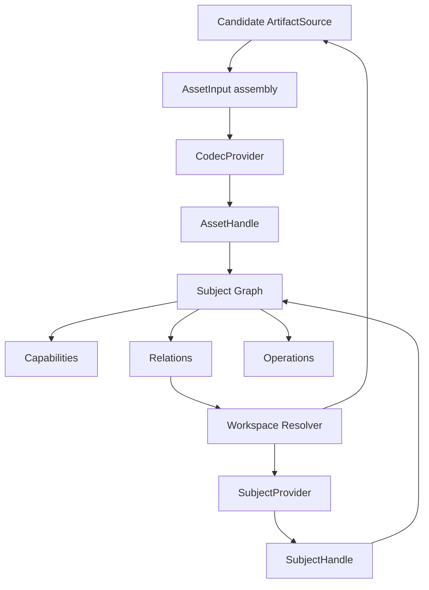

# 01. Domain Model

Status: **non-canonical design draft**  
Canonical: [Modkit Target Architecture](../architecture/MODKIT_ARCHITECTURE.md)  
Normative: **no; see README ownership map for normative-candidate sections**

## 1. Слои модели



## 2. Source

`ArtifactSource` описывает доступ к физическому или виртуальному содержимому:

- file;
- directory;
- in-memory bytes;
- random-access source;
- stream;
- HTTP/range source;
- archive entry;
- VFS mount;
- CASC/content-addressed source;
- browser file handle;
- generated or embedded source.

Source не утверждает формат и не содержит game semantics. Один source является
атомарным addressable handle, но не обязан соответствовать целому asset. Directory/VFS
root source может предоставлять namespace, а bundle asset может использовать несколько
sources.

```ts
interface ArtifactSource {
  readonly id: string
  readonly name?: string
  readonly revision?: string
  readonly capabilities: SourceCapabilitySet
}
```

## 3. Asset origin и input

Serializable origin отделён от открытых runtime handles. Единственные normative-candidate
определения `SourceBindingDescriptor`, `AssetOriginDescriptor` и `AssetInput` находятся в
[16 §3–4](16-composite-assets-and-origins.md#3-serializable-origin); этот overview намеренно не
повторяет сокращённую копию типов.

`primary` не является обязательным. Он помогает UX и format writer, но не определяет
identity. Полные правила описаны в
[16-composite-assets-and-origins.md](16-composite-assets-and-origins.md).

## 4. Subject и Asset

```ts
interface SubjectHandle {
  readonly ref: SubjectRef

  describe(signal?: AbortSignal): Promise<SubjectDescriptor>

  relations(query?: SubjectRelationQuery, signal?: AbortSignal): AsyncIterable<RelationRecord>

  operations(signal?: AbortSignal): Promise<OperationSession>
  close(): Promise<void>
}

interface AssetHandle extends SubjectHandle {
  readonly origin: AssetOriginDescriptor
  readonly identity: FormatIdentity
}
```

Разница принципиальна:

- PNG — asset и subject;
- SC2 Unit — subject, но не asset;
- sheet внутри XLSX — child subject и, при наличии virtual source, может быть asset;
- embedded Galaxy block — virtual asset и child subject;
- localization matrix из нескольких файлов — derived workspace subject.
- image + palette или CUE/BIN — bundle asset;
- CASC installation — namespace asset/content-store subject без primary file.

## 5. Descriptor и runtime handle

Descriptor сериализуем и пригоден для worker/process boundary:

```ts
interface SubjectDescriptor {
  readonly schemaVersion: 1
  readonly subject: SubjectIdentity
  readonly traits: readonly TraitInstance[]
  readonly operations: readonly OperationDescriptor[]
  readonly relationSummary?: RelationSummary
  readonly metadata: readonly MetadataGroup[]
  readonly diagnostics: readonly Diagnostic[]
}

interface AssetDescriptor extends SubjectDescriptor {
  readonly origin: AssetOriginDescriptor
  readonly identity: FormatIdentity
}
```

Runtime methods находятся в handle/provider и никогда не помещаются в descriptor.

## 6. Identity

Normative-candidate `SourceRef`, `SubjectIdentity`, `SubjectRef`, equality и URI serialization
определены только в
[25-subject-identity-editing-transactions-and-cache.md](25-subject-identity-editing-transactions-and-cache.md#3-многоуровневая-subject-identity).
Display title/labels/provider evidence являются presentation/detection metadata и не входят в stable
identity.

```ts
interface FormatIdentity {
  readonly format: string
  readonly mediaType?: string
  readonly categories: readonly string[]
  readonly confidence: number
  readonly evidence: readonly DetectionEvidence[]
}
```

Рекомендуемые адреса:

```text
file:///mods/Test.SC2Mod/GameData/UnitData.xml
modkit-asset://workspace/hash/path
modkit-vfs://workspace/GameData/UnitData.xml#blizzard.sc2%2Funit/Marine
modkit-vfs://workspace/UI/Main.SC2Layout#blizzard.sc2%2Fui-template/GameUI%2FPanel
file:///documents/Book.xlsx#common.table%2Fsheet/Sheet1
```

Адрес должен быть стабильным, restorable и не зависеть от display label. Перемещение
файла или смена mount/provider не обязаны менять logical subject identity. Source
address, asset identity и provider identity являются разными координатами.

## 7. Traits, capabilities и contracts

`SubjectDescriptor.traits` сегодня использует serializable `CapabilityInstance` из
`@modkitx/assets`; target TypeScript name — `TraitInstance`. Это механический rename API symbols
(`CapabilityId/Instance/Query` -> `TraitId/Instance/Query`) без изменения JSON field `traits` или
manifest data. Instance сообщает, **какие данные наблюдаемы**, их state/parameters/evidence.

Manifest field `capabilities` — другой, более грубый vocabulary codec verbs (`read`, `write`,
`inspect` и т. п.). Он не заменяет `traits`. Typed runtime API не извлекается из trait через
универсальный `SubjectHandle.get()`; его предоставляет выбранный provider **contract**, а действия
остаются `operations`. Это не позволяет одному слову `capability` одновременно означать данные,
метод, permission и service API.

## 8. Operation

Operation является действием и отдельно сообщает mutability, permissions и outputs:

```ts
interface OperationDescriptor {
  readonly id: string
  readonly state: OperationState
  readonly mutates: 'none' | 'subject' | 'sources' | 'workspace'
  readonly effects?: readonly (
    'read' | 'write' | 'network' | 'execute-runtime' | 'launch-process' | 'external-tool'
  )[]
  readonly inputSchema?: string
  readonly outputs?: readonly OperationOutputDescriptor[]
  readonly requiredPermissions?: readonly string[]
}
```

Примеры:

```text
view.thumbnail
model.render
audio.play
edit.field
edit.structure
source.save
archive.extract
content.resolve-dependencies
runtime.start
game.launch
```

## 9. Provider contract и offer

Provider contract — versioned runtime interface, который может иметь несколько
реализаций:

```ts
interface ProviderContract<TProvider> {
  readonly id: string
  readonly version: string
}
```

Единственная normative-candidate normal form `ProviderOffer`/`ProviderRequest` находится в
[23-contract-identity-schema-resolution-and-lock.md](23-contract-identity-schema-resolution-and-lock.md#8-normative-candidate-provider-types-v1).
Scope-local bundled/installed/app generated catalog нормализует target-specific variants в отдельные
offers. Federated marketplace catalog содержит release metadata и не является runtime offer catalog.
World systems/profiles
используют отдельный composition protocol.

## 10. Relation

Единственный normative-candidate serializable shape — `RelationRecord` из
[25 §13](25-subject-identity-editing-transactions-and-cache.md#13-relation-index). Provider-native
`relation` сохраняет точный field/path/edge kind, а optional `semanticRole` даёт общую семантическую
проекцию для viewers/search. Этот overview не вводит параллельный `kind + role` DTO.

Relation не открывает target автоматически. Resolution остаётся lazy, cancelable и
budgeted.

`companion` relation не заменяет binding. Обязательный owned sidecar, без которого asset
не открывается, входит в `AssetOrigin.bundle`; shared texture, optional preview или
внешняя dependency остаются relations.

## 11. Projection

Projection создаёт derived representation/traits или derived subject из уже доступных данных:

```ts
interface ProjectionProvider {
  readonly id: string
  readonly consumes: TraitQuery
  readonly provides: readonly string[]

  create(
    subject: SubjectHandle,
    context: ProjectionContext,
  ): Promise<CapabilityProvider | SubjectHandle>
}
```

В extension-manifest v2 такая реализация обнаруживается как `projections/<id>` contribution. Она
не получает source identity codec-а и не становится новым codec только потому, что создаёт
thumbnail, table, card или `Scene3D`.

Примеры:

- `PropertyGraph -> TableCollection`;
- `Scene3D -> PreviewImage`;
- `AudioStream -> Waveform`;
- `LocalizationWorkspace -> LocalizationMatrix`;
- `SC2 Unit + model relation -> EntityModelPreview`;
- `embedded source + source map -> LanguageDocument`.

## 12. Scope и lifetime

| Scope        | Lifetime                     | Примеры                       |
| ------------ | ---------------------------- | ----------------------------- |
| source       | пока открыт source           | random access, listing        |
| asset        | пока открыт artifact         | image frames, archive entries |
| subject      | пока открыт logical object   | unit fields, relations        |
| workspace    | пока открыт project          | indexes, localization matrix  |
| service      | lifetime provider generation | compression, transcoder       |
| operation    | один request/transaction     | export, rename, patch         |
| view-session | пока открыт viewer           | zoom, current page, selection |

UI state вроде current page не должен попадать в persisted artifact capability, если
сам формат не сохраняет это значение.

## 13. Stage and representation axes

Artifact stage и output representation являются разными осями. `ArtifactStage`
(`authored | compiled | runtime`) объявлен один раз в
[05 §1.1](05-codecs-and-asset-pipeline.md#11-format-roles-topology-и-artifact-stage) вместе с
остальными осями codec `spec`; здесь объявляется только вторая ось:

```ts
type OutputRepresentation = 'native' | 'decoded' | 'render' | 'editor' | 'transferable'
```

Например, provider может читать authored native XML и строить editor representation, а другой —
compiled native retail data и render representation. `derived` не является stage: это origin/
provenance из document 16. `partial` без stage, representation и provenance недостаточно
информативен.

## 14. Errors и absence

- `undefined` означает отсутствие optional capability.
- Corrupt source, crashed provider, permission denial и broken invariant являются
  ошибками с stable code/context/cause.
- Missing optional relation возвращает resolution state и diagnostic, а не бросает
  ошибку открытия родительского subject.
- `require()` бросает структурированную ошибку, `get()` допускает отсутствие.

Error definitions, worker/process transport, diagnostics и redaction подробно описаны в
[12-errors-and-diagnostics.md](12-errors-and-diagnostics.md).
