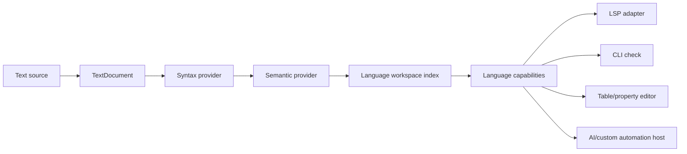

# 06. Viewers, Editors, and Language Services

Status: **non-canonical design draft**  
Canonical: [Modkit Target Architecture](../architecture/MODKIT_ARCHITECTURE.md)  
Normative: **no; see README ownership map for normative-candidate sections**

## 1. Глобальный contribution catalog и опциональные инструменты

Viewer/editor implementations не должны перечисляться внутри каждого subject.
Text/hex fallback, table, tree, property grid, timeline, relation graph, entity card, 2D/3D preview,
renderer, language analysis, LSP adapter и AI integration являются независимыми contributions. Ни
один из них, кроме явно выбранного минимального fallback profile конкретного продукта, не является
обязательной частью Modkit platform. Например, audio-player profile может не включать table/model/
language tools, а headless converter — не включать никакой UI.

```ts
interface ViewerContributionDeclaration {
  readonly id: string
  readonly consumes: TraitQuery
  readonly subjectKinds?: readonly string[]
  readonly relationRoles?: readonly string[]
  readonly target?: RuntimeTargetConstraint
  readonly requiresFacilities?: readonly string[]
  readonly slot: 'stage' | 'tree' | 'panel' | 'toolbar' | 'status'
  readonly priority: number
  readonly singletonGroup?: string
  readonly conflicts?: readonly string[]
  readonly runtime: ContractRequirement
}

interface ViewerRuntimeProvider {
  readonly contributionId: string
  create(input: ViewerRuntimeInput): Promise<ViewerFactory>
}
```

Workbench/application composition service сопоставляет installed или app-embedded offers с открытым
subject. Subject может сообщить semantic hints/roles, но не знает implementation IDs. Serializable
`SubjectDescriptor` не содержит installed inventory, selected native factories или machine-local
presentation plan.

Решение Q84 фиксирует три разные плоскости:

| Объект                     | Authority                   | Что разрешено хранить                                                                                               |
| -------------------------- | --------------------------- | ------------------------------------------------------------------------------------------------------------------- |
| `AssetDescriptor`          | subject/session             | observed traits, operations, constraints и logical data-source contract refs; никаких installed provider/viewer IDs |
| `ViewerContributionSpecV1` | global contribution catalog | requirements, consumed data-source contracts, target/facility constraints, slots и priority                         |
| `PresentationPlan`         | host, session-local         | выбранные bindings/slots/fallback для конкретных catalog + policy + revision snapshots                              |

`PresentationPlan` не сериализуется обратно в descriptor и не становится project authority. Это
разделение принято 2026-08-14 как basis BRIEF-13A/13C, но не frozen до stress/conformance gates A-5
и A-6.

## 2. Bounded contribution resolution

Один service-locator resolver, который одновременно знает VFS, codecs, installed inventory,
security и UI factories, запрещён. Оркестратор выполняет три ограниченные стадии:

1. **Subject facts → semantic offers.** Observed traits/operations/contracts/relations и descriptor
   revision дают переносимый набор подходящих ролей; `may-expose` не удовлетворяет hard route.
2. **Offers → activated provider selections.** Installed catalog snapshot, target/facilities,
   provider-policy lock, host security policy и grants отбрасывают недоступные реализации и дают
   rejection reasons. Эта стадия machine/session-local.
3. **Selected semantic offers → presentation plan.** Viewer shell разрешает singleton groups,
   conflicts, slots, modes и fallback без доступа к VFS/provider internals.

Общая primitive задаёт canonical ordering и typed rejection reasons, но стадии имеют разные input/
output types и cache. Cache key как минимум включает subject revision, installed catalog generation,
host-facility snapshot, security-policy digest, provider-policy revision и resolver version. Install/
remove, grant или pin инвалидируют соответствующую стадию независимо. Materialized presentation plan
является host/session snapshot; он не переносится как часть subject или project data.

## 3. Nested viewer

Generic relation preview contribution может открыть child subject и вложить его
совместимый viewer:

```text
SC2 Unit stage
  -> relation visual.primary-model
  -> resolved M3 AssetHandle
  -> model viewer contribution
```

Parent viewer не импортирует model renderer.

## 4. Viewer modes

```ts
type ViewerMode = 'thumbnail' | 'hover' | 'inline' | 'panel' | 'editor' | 'embed'
```

Один provider может поддерживать не все modes. Thumbnail должен иметь отдельный
budget и не активировать тяжёлый editor runtime.

## 5. UI state

Zoom, current page, active animation, selected node и expanded tree rows принадлежат
`ViewSession`, а не artifact descriptor.

```ts
interface ViewSession {
  readonly subject: SubjectRef
  readonly state: ViewStateStore
  dispose(): Promise<void>
}
```

Если active sheet сохраняется в XLSX, persisted value изменяется document operation,
а текущая UI selection остаётся view state.

## 6. Editing architecture

```text
DocumentSession
├── TextDocument
├── SyntaxTree
├── SemanticDocument
├── PropertyGraph
├── TableCollection
└── OperationSession
```

Все representations разделяют revision.

```ts
interface DocumentSession {
  readonly subject: SubjectRef
  readonly version: number

  snapshot(): Promise<DocumentSnapshot>
  apply(change: ChangeSet, expectedVersion: number): Promise<DocumentVersion>
  dispose(): Promise<void>
}
```

## 7. Semantic location

```ts
interface SemanticLocation {
  readonly subject: SubjectRef
  readonly node: string
  readonly property?: string
  readonly sourceRange?: Range
}
```

Mappings:

```text
text position -> SemanticLocation
table cell    -> SemanticLocation
tree node     -> SemanticLocation
property row  -> SemanticLocation
```

## 8. Value assistance ниже LSP

```ts
interface ValueAssistanceApi {
  complete(location: SemanticLocation): Promise<ValueCompletion[]>
  hover(location: SemanticLocation): Promise<ValueHover | undefined>
  validate(location: SemanticLocation): Promise<ValueDiagnostic[]>
  references(location: SemanticLocation): Promise<SemanticReference[]>
}
```

Text editor и table editor используют один API. Table не вызывает LSP JSON-RPC.

## 9. Language layering



Generic XML/Lua parser не знает SC2/Game semantics. Game extension добавляет semantic
contribution поверх syntax tree.

## 10. Language provider operations/features

```text
language.diagnostics
language.completion
language.hover
language.definition
language.references
language.rename
language.symbols
language.formatting
language.semantic-tokens
language.code-actions
```

Это operation/provider feature IDs, не subject traits. Наличие `code.syntax-tree` не обещает
completion/rename/formatting; конкретный language offer объявляет каждую поддержанную operation.

Нейтральные `Position`, `Range`, `Diagnostic`, `Completion`, `TextEdit` и
`WorkspaceEdit` не импортируются из `vscode-languageserver`.

## 11. LSP adapter

LSP server:

- конвертирует protocol types;
- управляет document synchronization;
- прокидывает cancellation;
- не парсит game formats;
- не декодирует image/audio/model;
- не владеет workspace semantics.

Те же providers должны работать in-process и в CLI.

## 12. Embedded documents

```ts
interface EmbeddedDocument {
  readonly ref: SubjectRef
  readonly language: string
  readonly parent: SubjectRef
  readonly sourceRange: Range
  readonly sourceMap: EmbeddedSourceMap
  readonly text: TextSnapshot
}
```

`sourceMap` переводит diagnostics и edits между virtual document и parent.

SC2 Triggers example:

```text
Trigger XML
  -> relation code.embedded
  -> Galaxy virtual document
  -> optional language.galaxy provider
  -> diagnostics/completion/rename
```

Без Galaxy provider raw text остаётся видимым.

## 13. Asset references в code/data

Semantic provider возвращает typed reference:

```ts
interface AssetReference {
  readonly origin: SemanticLocation
  readonly target: AssetReferenceTarget
  readonly expected: TraitQuery
  readonly role?: string
}
```

Hover/preview pipeline:

```text
semantic location
  -> AssetReference
  -> WorkspaceAssetIndex.resolve
  -> candidate source/origin
  -> AssetInput assembly
  -> AssetCodecHost.open
  -> capabilities
  -> ViewerContribution
```

Language provider не импортирует DDS/audio/model codec.

## 14. Completion assets

Schema/semantic model сообщает expected capability. Workspace index ищет candidates
без полной decoder activation:

```ts
assetIndex.query({
  text: currentPrefix,
  requires: [{ id: 'image.raster' }],
  scope: currentMod,
})
```

Thumbnail создаётся лениво для видимых rows и кешируется по revision/codec version.

## 15. Localization table

`LocalizationWorkspace` проецируется в `TableCollection`. Cell edit создаёт change
для одного source catalog. `ValueAssistance` доступен из текста и cell editor.

Cross-locale diagnostics являются workspace feature:

- missing key;
- duplicate key;
- placeholder mismatch;
- markup mismatch;
- fallback provenance;
- untranslated value.

## 16. Editor contribution

```ts
interface EditorContributionSpec {
  readonly sessionModel: 'single-subject' | 'multi-subject' | 'workspace'
  readonly selectionKinds: readonly string[]
  readonly semanticLocationKinds: readonly string[]
  readonly requiresTransactions: boolean
  readonly scaleLimits?: {
    readonly maximumSubjects?: number
    readonly maximumRows?: number
    readonly maximumSourceBytes?: number
  }
}

interface EditorContributionDeclaration {
  readonly id: string
  readonly consumes: TraitQuery
  readonly requiresOperations: readonly string[]
  readonly priority: number
  readonly spec: EditorContributionSpec
  readonly runtime: ContractRequirement
}
```

Наличие `table.cells` не подразумевает editor. Нужны edit и save operations.
`supportsDiff`/`supportsMerge` не входят в v1 до первого реального consumer; diff/merge подключаются
отдельными operations/providers, а не обещаются статическим boolean без доказательства.

Editor не владеет сохранением. Он создаёт `ChangeSet`/`AssetEditPlan`, codec/writer валидирует
семантику и round-trip claims, host commit coordinator повторно проверяет revisions/permissions и
выполняет transaction через source/VFS provider. Низкоуровневый byte range уже выражается
`SourceEdit`; generic `edit.binary-range` и `edit.batch` operations не вводятся.

## 17. ChangeSet

```ts
interface ChangeSet {
  readonly baseRevisions: Readonly<Record<string, string>>
  readonly edits: readonly SourceEdit[]
  readonly semanticIntent?: JsonValue
  readonly provenance: ChangeProvenance
}
```

Cross-file rename может затронуть catalog, triggers, strings и layouts, но должен
применяться атомарно или откатываться.

## 18. `language-contracts`, `language-host` и `lsp`

`language-contracts` содержит только portable browser-safe types, provider interfaces,
embedded document/source-map contracts и contribution descriptors. Он не владеет
sessions, indexes, caches, workers, LSP transport или Node integration.

В target v1 `language-host` композирует providers, revisions, workspace indexes, caches,
cancellation и worker/RPC activation. `lsp` владеет только server/transport adapters и conversion
между neutral и protocol DTO. Extensions зависят от contracts; host обнаруживает extensions через
catalog. Это исключает dependency cycle `host -> extension -> host`.

Они имеют полезные независимые режимы:

| Состав                                 | Допустимо | Результат                                             |
| -------------------------------------- | --------- | ----------------------------------------------------- |
| Только `language-contracts`            | Да        | SDK/types, но без анализа и sessions                  |
| Language extension + minimal test host | Да        | Unit/conformance tests и direct in-process calls      |
| Только `language-host`                 | Да        | Empty/raw-text host, routing, revisions, cancellation |
| Extension + `language-host`            | Да        | Headless/CLI/table/tree language features             |
| Extension + host + LSP adapter         | Да        | VS Code и другие LSP clients                          |
| Extension + host + automation adapter  | Да        | AI/tool access без LSP JSON-RPC                       |

Language extension не должна импортировать `@modkitx/lsp`; она регистрирует neutral
provider factories против `language-contracts`. Для production activation ей нужен
какой-либо host, но это может быть Modkit language host, test harness или другой
совместимый implementation.

Target host обязан компоновать несколько installed language extensions и несколько
providers одного языка. Политика «первый найденный extension wins» недопустима: syntax,
game semantics, embedded-language bridge и workspace index могут поставляться отдельно.

Текущий [`@modkitx/language-contracts`](../../packages/language-contracts/src/module.ts)
ещё использует типы `vscode-languageserver/node`, поэтому является transitional implementation, а
не доказательством target boundary; первым slice должны стать собственные neutral DTOs. Текущий
[CLI loader](../../apps/modkit-cli/src/language-extensions.ts) также нужно перевести с
одиночного optional contribution на merge catalog. Миграция должна сначала ввести neutral
DTOs и adapters, а затем перевести существующие providers без одновременного rewrite
semantics.

Физически нужны три package: portable `language-contracts`, neutral stateful `language-host` и
protocol-only `lsp`. Миграция breaking: permanent facade и параллельный public API не создаются.

## 19. `viewer-shell` и `workbench`

`viewer-shell` отвечает за одну subject/view session: stage, tree, panels, nested
relations, fallback, lifecycle. Он должен работать в hover/embed/wiki/standalone harness
без полного приложения.

`workbench` владеет workspace/project UI, tabs, navigation, search, Problems, settings,
marketplace/provider selection и lock review. Dependency направлена только
`workbench -> viewer-shell`; viewer contributions не импортируют workbench.

`viewer-shell` также не обязан поставлять конкретные table/tree/model renderers. Он предоставляет
slots, lifecycle, budgets и fallback protocol. Конкретный renderer/editor может поставляться bundled
common, сторонним extension или application embed profile. Альтернативные Three/WebGL/WebGPU/headless
backends являются provider offers одного render contract, а не hardcoded imports shell-а.

Полная package/dependency схема приведена в
[15-package-boundaries-and-extension-layout.md](15-package-boundaries-and-extension-layout.md).

## 20. Game UI documents не являются viewer-shell UI

SC2Layout, Spring/Recoil LuaUI/RmlUi, Flash/Scaleform и другие игровые интерфейсы
открываются в `viewer-shell` как subjects, но не используют его internal component model
как universal representation.

```text
native game UI source
  -> format-specific AST/semantic model
  -> DocumentSession + language/value assistance
  -> optional portable UiDocument projection
  -> selected renderer contribution
  -> optional World presentation bindings
```

Нужно сохранять две независимые extension surfaces:

- Modkit viewer/editor contribution, которая показывает или редактирует UI subject;
- game UI runtime contribution, которая исполняет layout/bindings внутри Multiverse или
  совместимого game runtime.

Game UI runtime работает в unsynced/presentation domain и не получает mutable simulation
state. Кнопка или widget изменяет игру только через typed input/world command. Embedded
simulation script извлекается отдельным subject и выполняется script runtime, а не UI
renderer.

Custom frame/node/property/renderer добавляется namespaced UI profile. При отсутствии
специализированного renderer остаются text/tree/properties/raw fallback и diagnostics.

Полный parsing/rendering/editing/binding plan приведён в
[21-game-ui-layouts-rendering-and-bindings.md](21-game-ui-layouts-rendering-and-bindings.md).

## 21. Generic Subject Viewer and code navigation

`EntityCard`, wiki panel и format-specific preview commands являются compatibility hosts. Target
flow одинаков для SC2 Unit, SC2Layout template, Lua widget, spreadsheet sheet и model animation:

```text
language/tree/search location -> SemanticLocation -> SubjectRef -> Open Subject
```

CodeLens может предложить `Open Subject`, `Preview`, `Show Usages` и `Open Source`, но не владеет
логикой сборки карточки. Subject Viewer композирует properties, relations, preview, timeline,
diagnostics и editor contributions из catalog. Один и тот же `SubjectRef` должен открываться из
LSP, tree, CLI и AI без зависимости от LSP transport.

## 22. Самостоятельность extension/tool contribution

Каждая executable contribution проектируется с двумя поверхностями:

```text
pure library/provider API
  + contribution.manifest + thin Modkit adapter
  + fixtures/conformance adapter
```

Pure library не импортирует `workbench`, global singleton registry или private host internals. Её
можно вызвать из unit tests, минимального совместимого host или другого Node/browser приложения.
Modkit adapter только переводит public lifecycle/transport DTO, регистрирует offer и применяет
grants/budgets. Это не обещает, что сложный provider полностью полезен без любого host: VFS,
document-session или GPU lifecycle может потребовать minimal contract host, но не полный Modkit app.

Обязательные самостоятельные proofs для public contribution:

- isolated build/package из отдельного repository без workspace aliases основного monorepo;
- direct library/provider test без workbench и без LSP transport;
- minimal-host conformance для manifest, lifecycle, cancellation, diagnostics и declared targets;
- negative dependency-boundary test против private package/extension imports;
- хотя бы один Modkit adapter integration test; для заявленных portable targets — отдельные Node/
  browser/worker fixtures.
