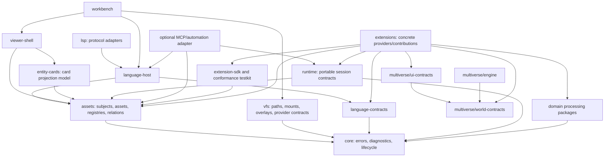

# 15. Package Boundaries and Extension Layout

Status: **non-canonical design draft**  
Canonical: [Modkit Target Architecture](../architecture/MODKIT_ARCHITECTURE.md)  
Normative: **no; see README ownership map for normative-candidate sections**

Финальное физическое target tree, extension-manifest v2 и полный planned format allocation находятся
в [document 27](27-final-target-tree-extension-manifest-and-format-catalog.md). Этот документ
объясняет dependency rationale и migration boundaries; его старые illustrative trees не
переопределяют document 27.

## 0. Сжатая package-модель (BRIEF-6; при конфликте выигрывает)

Нормативная целевая топология — [27 §0.1](27-final-target-tree-extension-manifest-and-format-catalog.md):
семь platform packages (`core`, `sdk`, `vfs`, `host`, `ui`, `runtime`, `testkit`) плюс два
обоснованных units (`lsp` — постоянный protocol adapter с иной dependency closure; `xml` —
reusable format library вне kernel). Разделы ниже сохраняют аргументацию границ, но их package
imена читаются как модули/subpaths §0.1-owner-ов: `language-contracts`→`sdk/language`,
`language-host`→`host/language`, `viewer-shell`/`workbench`/`embed`→subpaths `ui`,
`provider-host`/`extension-catalog`/`extension-installer`/`workspace`/product-inventory→модули
`host`, `processing/*`→библиотеки common/format extensions. Физическое выделение — только по
правилу 27 §0.4.

## 1. Главный принцип

Общая модель `SubjectHandle` не означает один физический package для всего. Package
boundary выбирается по dependency direction, runtime target, lifecycle и reuse. Folder
название не должно подменять public contract.



Стрелка означает compile-time dependency. Обратные связи выполняются через registry
offers/handles, а не imports.

## 2. `assets`, traits и operation resolver

```text
@modkitx/assets
  SubjectRef/Handle, AssetHandle, ArtifactSource
  AssetOriginDescriptor, SourceBindingDescriptor, AssetInput
  TRAIT_IDS + TraitInstance descriptor traits
  operations, relations, ProviderOffer/ProviderRequest
  operation-provider resolver + portable provider-policy lock v1

bundled-common or independent extension repository
  namespaced custom trait/contract definitions and runtime implementations
```

JSON vocabulary не меняется: descriptor field `traits` сохраняется, а codec manifest field
`capabilities` содержит coarse verbs. TypeScript `Capability*` symbols descriptor-слоя механически
становятся `Trait*`; typed runtime API называется contract. Отдельный `@modkitx/capabilities`
отложен; v1 не создаёт package только для перекладывания существующих IDs.

Core standard catalog должен оставаться небольшим. Game/vendor-specific schema не
переносится в standard package только ради общего registry.

Здесь находится **operation resolver**, который выбирает установленный provider для конкретной
операции. Install/marketplace resolver, dependency solving и distribution lock — другой будущий
слой; он не входит в v1 и не оправдывает новый package. Activation сначала остаётся внутренним
модулем assets/host composition root. Целевой `@modkitx/provider-host` выделяется только при первом
реальном worker/process execution profile и обслуживает не только codecs.

## 3. `language-contracts`, `language-host` и `lsp`

Целевая архитектура разделяет portable contracts, stateful neutral host и protocol adapter физически.
Проект пока не имеет внешних пользователей API, поэтому migration не сохраняет временный LSP-shaped
facade: neutral API извлекается сразу, а старые internal call sites меняются вместе с ним.

### `language-contracts`

- neutral `Position`, `Range`, `Diagnostic`, `TextEdit`, `WorkspaceEdit`;
- syntax/semantic/value-assistance provider interfaces;
- embedded document/source map contracts;
- contribution descriptors и transport-safe DTOs;
- browser-safe, без caches/workers/Node/LSP/VS Code imports.

### `language-host`

- document/workspace sessions и revisions;
- provider composition;
- indexes, caches, incremental invalidation;
- scheduling, cancellation, worker/RPC activation;
- transport-neutral navigation, diagnostics, edits и embedded-language orchestration.

### `lsp`

- LSP server lifecycle и wire-protocol adapters;
- conversion между LSP DTO и `language-contracts`;
- transport-specific cancellation, connection и capability negotiation;
- никаких game/language semantics и никакого собственного workspace model.

Это предотвращает цикл `host -> extension -> host`: extension зависит от contracts, host обнаруживает
extension через catalog, а `lsp` зависит от host. Нужны строгие export subpaths и
dependency-boundary test.

`language-contracts` полезен самостоятельно как SDK. `language-host` полезен без LSP для CLI,
table/tree editor, entity card, tests и AI tools; без extensions он остаётся empty/raw-text host.
Extension можно использовать с minimal test/custom host, но production document/workspace lifecycle
требует совместимый host. LSP является только одним из adapters/consumers neutral language service.

Текущий package с импортами из `vscode-languageserver/node` считается transitional:
целевой boundary доказан только после появления собственных neutral DTOs и browser
dependency test.

## 4. `viewer-shell` и `workbench`

### `viewer-shell`

Открывает один subject/session и композирует stage, tree, panels, toolbar/status slots,
nested relations, fallbacks и view lifecycle. Он embeddable в hover, wiki, standalone
preview, VS Code webview или full workbench. Shell не владеет concrete table/tree/property/model/
audio renderers; они приходят как optional tool contributions. Product profile выбирает только
нужный набор и может физически не включать остальные bundles.

### `workbench`

Владеет приложением: workspace/project, tabs, navigation/history, search, Problems,
settings, extension management, provider selection/lock review и global commands.

Dependency только `workbench -> viewer-shell`. Viewer contribution не импортирует
workbench. Разделение позволяет использовать preview/editor surfaces вне полного IDE UI и
не переносить workspace state в каждую view session.

### Multiverse world и game UI contracts

World/UI contracts не являются частями `@modkitx/core`. Их standalone package boundaries проходят
общее split rule. World v0 начинается как минимальный target-native Multiverse proof, SC2 runtime
codec служит внешним parity oracle, а UI
остаётся native SC2Layout representation + существующие processing/viewer adapters; имена будущих
packages не считаются реализованным ownership.

Целевой `@multiverse/ui-contracts` описывает игровые layouts, bindings и input intents. Он не
заменяет `viewer-shell`: первый относится к содержимому игры/HUD, второй — к embeddable UI
самого Modkit.

`multiverse/foundations/<foundation-id>` не входит в dependency closure engine/kernel. Каждый
foundation является ordinary preset из optional spatial/vitals/motion/navigation/RTS mechanic
contributions и reference systems. Game extension может выбрать его части, заменить provider через
public slot либо не использовать preset.

World/UI contract packages не импортируют concrete game extensions. Game extensions
зависят от public contracts и регистрируют profiles/components/systems/renderers через
catalog offers. Подробнее:

- [20-world-api-abi-and-multiverse-integration.md](20-world-api-abi-and-multiverse-integration.md);
- [21-game-ui-layouts-rendering-and-bindings.md](21-game-ui-layouts-rendering-and-bindings.md).

## 5. Processing packages

Не следует заменять `image-processing`, `audio-processing`, `models-processing` и
container/media processing одним `assets` или `subjects` package. Они имеют разные data
models, heavy dependencies, runtime targets и performance/security profiles.

Рекомендуемый target:

```text
packages/image-processing
packages/audio-processing
packages/media-processing
packages/models-processing
packages/container-processing
packages/rendering-3d/scene
```

Compression algorithms могут получить отдельный package только при реальном shared code
и независимых dependencies. Конкретные installed formats/providers обнаруживаются из
extensions, а не перечисляются processing package. Детали слоёв см. в
[14-processing-and-codec-layering.md](14-processing-and-codec-layering.md).

Текущий `archives-processing` не требуется немедленно переименовывать: сначала contracts,
adapters и parity, затем ownership move отдельным reversible change.

`@modkitx/rendering-3d/scene` является целевым владельцем renderer-neutral
`RenderModel`/`Scene3D` contracts. `models-processing` владеет model processing/conversion APIs и
зависит от scene contracts, но не определяет конкурирующий universal model DTO. Concrete native
model documents остаются в format extensions.

## 6. Packages, которые Proposal может добавить или выделить

Финальное physical tree определено только в [document 27](27-final-target-tree-extension-manifest-and-format-catalog.md).
Этот раздел фиксирует migration ownership, а не альтернативное дерево. Все существующие packages,
не имеющие выполненного migration slice, сохраняют current canonical ownership до переноса с parity
proof.

```text
portable contracts
  core, assets, vfs, language-contracts, runtime

stateful hosts and product composition
  language-host, lsp adapter, viewer-shell, entity-cards, workbench, provider-host

domain leaves
  processing/*, rendering/*, replay-player

independent/gated Multiverse ownership
  multiverse/world-contracts, engine, ui-contracts, foundations/*

concrete implementations
  bundled common: main-repo extensions/common/<id>
  vendor/game/community: independent extension repository/artifact
```

VFS ownership следует canonical architecture: `@modkitx/vfs` владеет contracts и target
foundational implementations. Target-first VFS slice мигрирует consumers и удаляет `@modkitx/io`;
public facade не остаётся. Вынос Git/API/cloud providers в extensions — открытое divergence, а не
уже принятое перемещение.

## 7. Нужен ли `src` в extension

`src` не является архитектурным требованием. Он полезен, когда нужно отделить compilable
source от manifests, schemas, docs, fixtures, assets, tests и generated/dist output.

Рекомендуемые правила:

- extension только с manifests/assets может обходиться без root `src`;
- shared TypeScript runtime extension обычно хранится в `src/`;
- codec-owned implementation остаётся в `codecs/<id>/src`, если codec является отдельной
  build/publication unit;
- не держать одновременно конкурирующие `src/viewers` и root `viewers` без явного
  ownership различия;
- manifests/schemas не прятать в `src`, если catalog generator должен читать их без
  compilation;
- generated output не смешивать с authored source.

Допустимы два профиля.

### Compact extension

```text
modkit-extension-git-source/
├── extension.json
├── package.json
├── README.md
├── source-providers/
│   └── git/
│       ├── contribution.manifest.json
│       └── src/index.ts
└── test/
```

### Multi-provider extension

```text
modkit-extension-starcraft-2/
├── extension.json
├── package.json
├── README.md
├── definitions/
│   ├── contracts/
│   ├── traits/
│   ├── subject-kinds/
│   ├── errors/
│   └── relation-kinds/
├── codecs/
├── subject-providers/
├── language-providers/
├── service-providers/
├── subject-viewers/
├── runtime-providers/
├── projections/
├── presets/
├── world/
├── game-ui/
├── src/shared/
├── fixtures/
└── test/
```

Выбор профиля задаётся tooling convention, а runtime catalog не должен зависеть от
наличия папки с конкретным именем. Эти деревья являются repository roots target state; current
monorepo paths остаются migration state. Bundled common использует тот же layout под
`extensions/common/<id>`.

Scaffolder, generated catalog fragments, host portability и parallel-agent rules описаны в
[19-host-portability-performance-and-extension-dx.md](19-host-portability-performance-and-extension-dx.md).
Federated publication, catalogs, install lock и product inventory определены в
[28-extension-distribution-catalog-installation-and-product-discovery.md](28-extension-distribution-catalog-installation-and-product-discovery.md).

### 7.1 Library-first contribution layout

Executable extension unit должна отделять самостоятельно тестируемую реализацию от Modkit adapter:

```text
<id>/
├── contribution.manifest.json
├── src/
│   ├── library.ts          pure/provider API; no workbench/global registry imports
│   └── modkit-adapter.ts   offer registration + lifecycle/transport adaptation
├── fixtures/
├── conformance/
└── test/
    ├── library.spec.ts
    └── minimal-host.spec.ts
```

Имена файлов являются convention, не discovery contract. Data-only contributions могут не иметь
`src`; сложной реализации может требоваться minimal VFS/document/GPU host, но никогда полный
workbench только ради unit/conformance test. Publication обязана собираться вне main-repository
workspace aliases. Extension, содержащая несколько units, может иметь shared pure libraries, однако
каждый public contribution остаётся независимо адресуемым manifest-ом и test profile.

## 8. Dependency rules

1. Browser-safe contracts не импортируют `node:*`, React, VS Code или LSP transport.
2. Core/packages не импортируют concrete extension implementation.
3. Extension может зависеть от public package contracts, но не от private host internals.
4. Viewer/editor/language offers discover implementations через scope-local embedded/installed
   generated catalog.
5. Workbench может зависеть от shell/hosts; обратная зависимость запрещена.
6. Processing package не импортирует installed formats catalog.
7. Cross-domain reuse проходит через portable trait/operation/provider contract.
8. Root barrels не реэкспортируют heavy domains без explicit opt-in.
9. Package cycles блокируют merge независимо от runtime lazy import.
10. Runtime contracts не импортируют game-specific launch implementation.
11. AI/MCP adapter зависит от public workspace/subject/operation APIs; core не зависит от
    adapter или LLM SDK.
12. Extension SDK зависит от portable contracts; core/runtime hosts не зависят от SDK или
    scaffolder.
13. Independent extension не импортирует private runtime/class другого extension; integration
    проходит через public provider/trait/contract transport boundary.
14. Catalog discovery не требует authored central switch/barrel edits.
15. `@modkitx/runtime` не импортирует World/UI contracts; game runtime adapter зависит от
    обоих направленно.
16. `@multiverse/engine` не импортирует Modkit assets/workspace/VFS или concrete game
    extensions.
17. Game UI contracts не импортируют viewer-shell/workbench/React/DOM; конкретный renderer
    подключается provider contribution.
18. Main repository packages не импортируют external extension repository source; only generated
    app/installed loaders reference verified artifact entrypoints.
19. Catalog query/product matching не активируют extension implementation.
20. Concrete viewers/editors/renderers/language/LSP/automation tools не являются transitive
    dependencies portable subject/assets contracts и подключаются только выбранным product profile.
21. Extension library/provider тестируется без full Modkit app; Modkit adapter зависит только от
    public SDK/contracts и остаётся тонким integration layer.

## 9. Migration order

1. Зафиксировать public contract/subpath boundaries без перемещения implementations.
2. Добавить dependency graph tests для запрещённых направлений.
3. Оставить trait definitions в `@modkitx/assets`; не создавать capability package в v1.
4. Выделить portable language types и stateful neutral `language-host`; сократить `@modkitx/lsp`
   до protocol adapters без временного public facade.
5. Выделить embeddable viewer shell из workbench-only state.
6. Подключить concrete implementations через manifests/catalog.
7. Перемещать processing/provider files небольшими slices с parity tests.
8. Удалить compatibility exports после миграции всех consumers.
9. Добавить SDK/testkit/scaffolder только после стабилизации первого contract slice.
10. Перевести generated catalog на per-extension release fragments и раздельную deterministic
    aggregation для bundled-common development, app bundle и installed state.
11. Доказать independent local artifact: clean common-only host загружает external extension без
    checkout/workspace enrollment/root switch.
12. Ввести declarations/compiled schedule над текущим `SimWorld`, не создавая standalone kernel.
13. Ввести game UI subject/contracts и SC2Layout adapter до попытки общего UI renderer.
14. Извлекать Multiverse systems и portable UI profiles только после parity/conformance
    вертикальных proofs.

## 10. Acceptance criteria

- Empty host импортирует core/contracts без game/format runtimes.
- `language-contracts` проходит browser import test и не зависит от `@modkitx/lsp`.
- `language-host` запускает CLI/table/AI language flow без LSP transport; `@modkitx/lsp` не владеет
  вторым workspace/session model.
- Viewer shell открывает subject в standalone harness без workbench.
- Workbench removal не ломает viewer provider compilation/conformance.
- Extension-defined provider contract компилируется против public SDK и обнаруживается catalog;
  custom manifest trait отдельно помечен future schema slice.
- Новый Git/API VFS provider подключается без правки codec routing; существующий provider не нужно
  физически перемещать в v1.
- Processing dependency graph не содержит `packages -> extensions` edges.
- Оба допустимых extension layout профиля проходят один manifest/catalog validator.
- Independent augmenter/OS port компилируется без base implementation import.
- Bundled/linked/installed extension обнаруживается без изменения authored central registry/barrel.
- Generic application ships only bundled common; external extension artifact from independent
  repository loads without source checkout or root workspace enrollment.
- Marketplace/app/installed catalogs and project locks are not written into one root `generated/`.
- Extension SDK/testkit не входят в runtime bootstrap dependency closure.
- World v0 declarations компилируют текущий `SimEngine` order без нового package/import cycle.
- Fixture extension заменяет один deterministic system slot с snapshot/hash conformance без
  изменения остальных systems.
- Game UI renderer contribution удаляется физически без потери native text/tree inspection.
