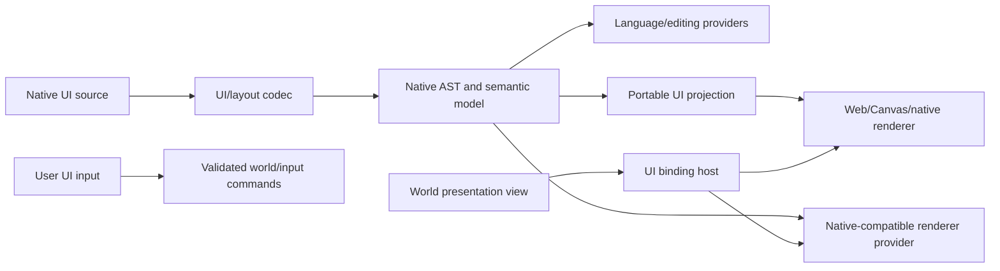

# 21. Game UI Layouts, Rendering, and World Bindings

Status: **non-canonical detailed design; paired UVI/UVY candidate profiles reserved by P0 docs pass**  
Canonical: [Modkit Target Architecture](../architecture/MODKIT_ARCHITECTURE.md)  
Normative: [UVI interface](../multiverse/interface/SPEC_UVI.md) and
[UVY style](../multiverse/style/SPEC_UVY.md) candidate specifications; stable portable UI packages
remain gated future work

Связанные detailed contracts: nested identity/edit transactions —
[25-subject-identity-editing-transactions-and-cache.md](25-subject-identity-editing-transactions-and-cache.md),
presentation extraction/clock/world domains —
[26-world-state-scheduler-snapshots-and-domains.md](26-world-state-scheduler-snapshots-and-domains.md).

Scope: parsing, semantic analysis, preview, editing и runtime rendering игровых
интерфейсов, включая SC2Layout, Spring/Recoil UI и будущие SAGE/game-specific layouts.

## 1. Два разных значения UI

Proposal различает:

1. **Modkit product UI** — workbench, viewer-shell, panels, property grids, editors.
2. **Game UI content** — HUD, menus, dialogs, frames, styles, bindings и scripts,
   поставляемые игрой или модом.

`viewer-shell`/`workbench` относятся к первому. SC2Layout, RmlUi, LuaUI, Scaleform,
HTML/CSS-подобные документы и proprietary layout formats относятся ко второму. Они могут
просматриваться внутри viewer-shell, но не должны смешиваться с его component model.
Поэтому extension-manifest v2 использует физически разные contribution directories:
`subject-viewers`/`subject-editors` для Modkit product UI и `game-ui` для игровых
documents/renderers/bindings/input intents.

## 2. Не один Universal UI DOM

У разных UI systems несовместимые layout, style, lifecycle и script semantics:

- SC2Layout использует frame types, templates, anchors, properties и game bindings;
- Spring/Recoil может использовать LuaUI, OpenGL drawing, Chili/FlowUI или RmlUi;
- Flash/Scaleform сочетает timeline, vector assets и ActionScript;
- HTML/CSS использует DOM, cascade и browser layout;
- proprietary games могут хранить binary widgets, scripts и texture atlases.

Поэтому универсальными являются protocol boundaries и стабильные profiles, а не один
обязательный lossless tree для всех UI formats.

Каждый codec сохраняет:

```text
native source/AST/semantic representation
  + optional portable UI projection
  + native extensions/provenance/loss report
```

## 3. Layered pipeline



Parsing, projection, rendering и editing могут поставляться разными providers. Наличие
parser не подразумевает наличие renderer или writer.

## 4. Package ownership

Целевая граница после portable-UI gate:

```text
@multiverse/ui-contracts
  portable UI document/view-model/binding/input contracts
  no DOM, React, Modkit workspace or concrete renderer

@modkitx/language-contracts
  text/source-map/diagnostic/edit contracts

@modkitx/viewer-shell
  embeds a selected game-UI viewer contribution

layouts-processing / reusable processing packages
  shared syntax/layout algorithms where genuinely cross-extension

game/format extensions
  SC2Layout, RmlUi, LuaUI, Scaleform, SAGE and other concrete codecs/providers
```

До gate новые packages не создаются. Целевой portable interface называется **UVI**: valid HTML
`.uvi.html` + optional canonical `.uvi.json` for typed bindings/templates. Повторно используемые
стили и темы образуют отдельный **UVY**: valid CSS `.uvy.css` + optional `.uvy.json` для typed
tokens/profile metadata. UVI подключает UVY обычным `<link rel="stylesheet">`. Less/Sass остаются
authoring languages и компилируются в UVY CSS с source maps, но не входят в portable runtime.
Renderer/session остаются contributions существующих hosts;
отдельный `@multiverse/ui-runtime` не создаётся без независимого lifecycle/consumer proof. Первый
proof использует native SC2Layout AST/semantic model,
существующие `layouts-processing`, `@modkitx/language-contracts`, `@modkitx/lsp` и viewer-shell
contribution. `@multiverse/ui-contracts` выделяется только после двух разных UI formats и
доказанного portable subset; game client тогда сможет использовать contracts без Modkit.

## 5. Game UI assets, nested subjects and capabilities

UI нельзя описывать одним словом `asset`. Для одного SC2Layout-like source одновременно
существуют разные identity/lifecycle:

| Объект                                                       | Представление                                         | Lifecycle               |
| ------------------------------------------------------------ | ----------------------------------------------------- | ----------------------- |
| `.SC2Layout`/Flash/RmlUi source или bundle                   | `Asset` с origin/revision                             | persisted source        |
| Весь разобранный UI document/collection                      | корневой `Subject` этого asset                        | document session        |
| Template, frame declaration, style, animation, script/widget | nested `Subject` с stable `SubjectRef` и source range | та же document revision |
| Инстанцированное frame/widget tree                           | state внутри `UiRuntimeSession`                       | transient               |
| Screenshot, thumbnail, accessibility tree, compiled plan     | derived asset/projection с provenance                 | cacheable result        |

Вложенный subject не обязан иметь отдельный файл. Например, один SC2Layout file может содержать
несколько addressable templates и animations, а один Blender/Flash document — коллекции сцен,
objects и timelines. `SubjectRef` включает owner source и semantic path/stable declaration ID;
document revision хранится отдельно. Raw byte offset не является identity, потому что меняется
после edit.

Native UI document и его nested subjects могут публиковать:

```text
ui.document
ui.tree
ui.frames
ui.template
ui.styles
ui.layout
ui.bindings
ui.action-declarations
ui.timeline
```

Этот список не является закрытым enum. Game extension может добавить, например:

```text
blizzard.sc2/ui-frame-types
blizzard.sc2/ui-state-groups
opensource.spring/lua-widget
ea.sage/ui-control
```

Trait описывает наблюдаемые данные. Preview/runtime session являются contracts, validate/render/edit/
compile/export — operations, а viewer contribution — конкретная поверхность в host. Наличие
`ui.action-declarations` означает, что declarations доступны для inspection; оно не обещает, что
host может их выполнить.

Codec обязан перечислять nested subjects лениво и уметь разрешить `SubjectRef` обратно к source
location. Это позволяет открыть template из кода, relation graph или поиска без открытия
фиктивного отдельного file asset.

Для SC2Layout canonical declaration key использует авторский регистр FQN, но equality следует
native case-insensitive semantics. Несколько XML declarations могут сливаться в один semantic FQN;
поэтому mapping `SemanticLocation -> SubjectRef` является N:1, а reverse navigation может вернуть
несколько locations. Runtime frame instances остаются session handles и не сериализуются как
`SubjectRef`.

### 5.1 Preview context and fixtures

Template/frame preview почти всегда неполон без окружения. Preview request задаёт context явно:

```ts
interface UiPreviewContext {
  readonly viewport: { width: number; height: number; scale?: number }
  readonly locale?: string
  readonly theme?: string
  readonly templateParameters?: Readonly<Record<string, UiValue>>
  readonly bindings?: UiBindingFixture
  readonly state?: Readonly<Record<string, UiValue>>
  readonly timelineTimeSeconds?: number
  readonly deterministicSeed?: number
}
```

Отсутствующие bindings не читаются неявно из live game/process. Editor использует fixture/mock,
replay viewer — replay-scoped presentation view, game runtime — разрешённый world presentation
view. Preview result хранит context hash и fidelity diagnostics, поэтому screenshot можно
воспроизвести.

## 6. Portable UI projection

Минимальная portable projection предназначена для preview, common editor tooling и
Multiverse-native UI. Она не обязана losslessly выразить каждый native construct.

```ts
interface UiDocument {
  readonly id: string
  readonly version: string
  readonly roots: readonly UiNode[]
  readonly styles?: readonly UiStyleRule[]
  readonly resources?: readonly UiResourceRef[]
  readonly bindings?: readonly UiBinding[]
  readonly extensions?: Readonly<Record<string, unknown>>
}

interface UiNode {
  readonly id: string
  readonly type: string
  readonly children?: readonly UiNode[]
  readonly properties?: Readonly<Record<string, UiValue>>
  readonly layout?: UiLayout
  readonly styleClasses?: readonly string[]
  readonly extensions?: Readonly<Record<string, unknown>>
}
```

Portable core должен оставаться небольшим:

- tree/identity;
- text/image/model/viewport resource references;
- basic box/anchor/constraint layout profiles;
- style/property values;
- bindings и input actions;
- accessibility/semantic roles;
- provenance и extension payloads.

Complex native templates, script objects, animation timelines или renderer-specific shaders
остаются profiles/extensions до появления независимых consumers.

## 7. Extensible UI nodes, properties and renderers

Game/third-party extension может добавить custom UI construct через согласованный bundle:

```ts
interface UiNodeTypeDefinition {
  readonly id: string
  readonly version: string
  readonly properties: SchemaRef
  readonly allowedChildren?: readonly ContractRequirement[]
  readonly events?: readonly ContractRequirement[]
  readonly fallback: 'container' | 'placeholder' | 'hidden' | 'error'
}

interface UiRendererContribution {
  readonly id: string
  readonly consumes: ContractRequirement
  readonly targets: readonly ('dom' | 'canvas' | 'webgl' | 'webgpu' | 'native')[]
  readonly modes: readonly ('preview' | 'runtime' | 'thumbnail')[]
  readonly entrypoint: RuntimeEntrypointRef
}
```

Custom renderer не получает private layout codec object. Он читает public native or
portable capability. Если renderer отсутствует, viewer показывает tree/properties/raw
source и structured degraded diagnostic.

## 8. World bindings

UI не читает mutable world storage напрямую. Binding host получает read-only,
visibility-scoped presentation view:

```ts
interface UiWorldBindingContext {
  readonly tick: number
  readonly viewer: WorldAccessScope
  query(request: UiWorldQuery): Promise<UiValue>
  subscribe(request: UiWorldSubscription): AsyncIterable<UiBindingEvent>
}
```

Binding examples:

```text
selected unit life/shields
player resources and supply
ability cooldown
replay current time/speed
objective state
unit portrait/model preview
localized string
```

World profile/game extension предоставляет explicit binding adapters. UI expression не
угадывает component IDs по строковым property paths.

Для hot HUD bindings runtime компилирует logical paths в numeric query/binding IDs и
обновляет batch view-model buffers. Provider resolver не вызывается каждый frame.

## 9. UI input back into simulation

Presentation domain не мутирует simulation state. Button, selection или pointer action
создаёт typed input intent:

```ts
interface UiInputIntent {
  readonly action: string
  readonly player?: WorldHandle
  readonly sourceNode: string
  readonly payload?: UiValue
}
```

Input mapper преобразует intent в:

- local presentation action;
- workbench/editor operation;
- synchronized `WorldCommand`;
- server-authoritative request;
- external operation только после отдельной permission/confirmation policy.

Игровой HUD не может вызвать filesystem, network или process только потому, что layout
содержит action name.

## 10. Synced and unsynced boundary

Game UI по умолчанию работает в `presentation-unsynced` domain:

- может читать только разрешённый player/observer view;
- не участвует в deterministic state hash;
- может работать с interpolation и display time;
- может быть отключён/заменён без desync;
- отправляет simulation changes только через input log.

Если игра содержит UI-authored logic, влияющую на simulation, codec обязан извлечь её как
embedded script/scenario subject и выполнить через synced script/runtime contracts. Сам UI
renderer не становится synced runtime.

## 11. SC2Layout path

SC2 extension должна сохранить несколько независимых representations:

```text
SC2Layout source
  -> native syntax tree and source map
  -> resolved frame/template/property semantic model
  -> language diagnostics/completion/references/rename
  -> native-compatible visual renderer
  -> optional portable UiDocument projection
```

Текущие parser, selector, schema resolution, property bindings и HTML/render primitives
являются implementation evidence, но не должны определять universal UI contract только по
SC2 terminology.

Existing HTML output оформляется как один DOM renderer provider. Он не становится обязательным
runtime backend и не должен быть отдельной веткой semantics. После parsing/resolution codec
компилирует public `UiRuntimePlan`; editor preview, replay preview и game runtime используют этот
же plan с разными binding contexts и renderer targets.

SC2-specific frame types, state groups, anchors, animations и game bindings сначала
остаются `blizzard.sc2/*`. Common anchor/constraint concepts могут быть promoted после
сравнения с другими UI systems.

SC2 Unit/ability/entity viewer использует те же relations и world bindings для icon,
portrait, model, localized text и runtime values. Layout codec не импортирует DDS/M3
implementations; он запрашивает asset capabilities.

## 12. Spring/Recoil path

Spring/Recoil support состоит из разных surfaces:

- RmlUi/markup documents могут иметь portable structural projection;
- LuaUI/widgets являются script subjects с unsynced host и UI contributions;
- OpenGL drawing code не обязано конвертироваться в UiDocument;
- Chili/FlowUI-like libraries могут предоставлять собственные node/profile/renderers;
- synced-to-unsynced messages становятся presentation events/bindings.

Цель — совместимое исполнение и preview через providers, а не обещание автоматически
перевести произвольный Lua/OpenGL UI в SC2Layout или portable DOM.

Lua-generated UI может оставаться script asset, публиковать widget/contribution subjects и
исполняться sandboxed unsynced script host. Если static tree до исполнения неизвестен, codec не
создаёт фиктивный `UiDocument`; runtime session может публиковать transient inspected tree как
отдельную derived representation.

## 13. SAGE and other engines

Для неизвестного или частично reverse-engineered UI codec достаточно начать с:

1. native source/container parsing;
2. hierarchy/property traits;
3. asset relations;
4. diagnostic/raw fallback;
5. format-specific preview provider;
6. optional portable projection с fidelity report.

Отсутствие универсальной проекции не блокирует native UI inspection и не делает весь game
extension unsupported.

## 14. Editing and language integration

UI document использует общую `DocumentSession` и единый revision для:

```text
text editor
frame tree
property grid
visual designer
binding editor
language/LSP features
```

Visual edit возвращает semantic `ChangeSet`, а codec/writer строит минимальный native
source patch. Embedded scripts и expressions имеют source maps. Cross-file rename может
затронуть layouts, strings, images, models, scripts и game data через workspace relation
graph.

Portable projection не становится source of truth для native file, если codec не объявил
round-trip guarantee.

### 14.1 Generic Subject Viewer вместо специальной wiki

Entity Card/Mod Wiki сохраняются как compatibility presentation, но общая команда называется
`Open Subject`. Language provider возвращает:

```text
source declaration -> SemanticLocation -> SubjectRef
```

Host может показать одинаковые CodeLens/actions возле SC2 Unit, SC2Layout template, Lua widget,
animation declaration или другого semantic object:

```text
Open Subject
Preview
Show Usages
Open Source
```

Конкретный Subject Viewer композирует доступные contributions. Карточка SC2Layout template может
показать source, hierarchy, inherited templates, parameters, properties, asset relations,
usages, diagnostics, preview и timeline. Она не требует отдельного hardcoded
`showSc2LayoutTemplateCard` API.

LSP/CodeLens — только один adapter. Tree view, workspace search, CLI и AI могут разрешить тот же
`SubjectRef` напрямую через language/subject contracts. Текущий VS Code Entity Card CodeLens
является migration source, а не финальным generic implementation.

## 15. Runtime rendering session

Перед созданием session providers компилируют immutable plan:

```ts
interface UiRuntimePlan {
  readonly document: string
  readonly subject?: string
  readonly sourceRevision: string
  readonly rendererContract: ContractRequirement
  readonly resolvedTemplates: readonly string[]
  readonly resourceRelations: readonly string[]
  readonly bindingPlan?: string
  readonly fidelityDiagnostics: readonly string[]
}
```

Plan содержит public/native capability references, но не private parser classes. Один plan можно
передать DOM, Canvas, WebGL/WebGPU, native или headless renderer, если target удовлетворяет
required renderer contract.

```ts
interface UiRuntimeSession {
  readonly plan: UiRuntimePlan
  readonly target: UiRenderTarget
  update(view: UiPresentationView): Promise<UiFrameResult>
  input(event: UiHostInput): Promise<readonly UiInputIntent[]>
  snapshot?(): Promise<UiSessionSnapshot>
  dispose(): Promise<void>
}
```

UI session владеет transient состоянием:

- focus/hover/selection;
- scroll;
- open dialogs;
- animation time;
- resolved layout cache;
- renderer resources.

Persisted layout/data changes проходят только через document operation. UI runtime
snapshot не смешивается с deterministic world snapshot, но replay/player может отдельно
сохранять presentation state.

## 16. Rendering backends

Renderer выбирается по contract/output и target:

```text
DOM/CSS       editor and web previews
Canvas2D      lightweight embeds
WebGL/WebGPU  game HUD, model viewports, effects
native        desktop/game client
headless      layout measurement, screenshots, accessibility tree
```

Один codec не обязан поставлять все backends. Screenshot/thumbnail operation может
использовать headless renderer, а runtime — WebGPU/native implementation.

Model viewport внутри UI разрешает `RenderModel`/render asset provider по relation, а не
встраивает model codec в UI package. Аналогично работают audio, video, textures и fonts.

## 17. Security and budgets

1. Native UI source считается untrusted content.
2. Parsing и static preview не активируют scripts автоматически.
3. Script/UI host объявляет domain, permissions, memory/instruction/frame budgets.
4. External links, filesystem, network и process actions запрещены без operation policy.
5. Binding queries ограничены visibility scope и batch/result budgets.
6. Custom shaders/renderers требуют compatible trusted runtime variant.
7. UI input, отправленный в simulation/network, валидируется как обычная world command.
8. Renderer crash изолируется и оставляет tree/raw fallback.

## 18. Development plan

### UI0 — Inventory and contracts

- описать native SC2Layout representations и current renderer boundaries;
- определить UI subject capabilities и contribution kinds;
- определить source asset, nested subject, runtime instance и derived preview identities;
- определить `UiPreviewContext`/fixture и stable SubjectRef для declarations;
- отделить game UI от viewer-shell/workbench UI;
- добавить conformance fixtures для tree/properties/assets/bindings.

### UI1 — SC2Layout adapter

- адаптировать native AST/semantic model к DocumentSession;
- связать language/value assistance, tree и property editor;
- оформить existing browser-safe `layoutToHtml` как `preview: structural` renderer contribution;
  он потребляет permissive AST и не обещает visual fidelity resolved layout;
- добавить template CodeLens через generic `SemanticLocation -> SubjectRef`;
- добавить structured fidelity report и import-boundary test: static inspection path физически не
  имеет script-host dependency.

### UI2 — Portable projection and renderer (future gate)

- minimum UiDocument schema;
- immutable `UiRuntimePlan` отдельно от parser private objects;
- DOM/Canvas reference renderer;
- custom node fallback;
- asset relation resolution без direct codec imports.

Gate открывается только когда два разных UI formats проходят общие conformance fixtures и каждый
публикует explicit preserved/approximated/omitted fidelity report. Два renderer одного SC2Layout и
произвольный процент совпавших nodes не являются доказательством portable semantics.

### UI3 — World binding bridge (after World v0 and UI2 proof)

- presentation-scoped world queries/events;
- compiled batch binding plan;
- UI input intents -> validated commands;
- replay timeline binding.

### UI4 — Spring/Recoil proof (opens portable-UI gate)

- один RmlUi/markup structural path;
- один LuaUI unsynced script contribution;
- synced-to-unsynced event bridge;
- доказать, что unsupported OpenGL drawing сохраняется как native representation.

### UI5 — SAGE/other proof (future)

- hierarchy/properties/assets для одного verified UI source;
- native preview либо explicit missing-provider state;
- promotion только реально общих layout/style contracts.

## 19. Acceptance criteria

UI0–UI1 acceptance for the first proof:

1. SC2Layout открывается как text/tree/property/preview через одну revision.
2. Layout preview не импортирует DDS/M3 codec implementation напрямую.
3. Missing specialized renderer оставляет raw/tree/diagnostics usable.
4. UI scripts не активируются при обычном static inspection.
5. Native round-trip loss публикуется явно.
6. Template/frame/style/animation открываются как nested subjects без fake files.
7. Один SC2Layout template открывается через generic `Open Subject` CodeLens и показывает
   preview/timeline при наличии соответствующих providers.
8. Preview fixture фиксирует viewport/locale/parameters/bindings/time и воспроизводит одинаковый
   headless result.

После открытия portable-UI/World gates дополнительно проверяются custom node fallback, immutable
presentation view, typed input commands, renderer replacement, Spring native preservation,
replay/world bindings и общий `UiRuntimePlan`. Эти критерии не блокируют первую документационную и
SC2Layout migration slices.

## 20. Open questions before stable v1

1. Называть standalone package `@multiverse/ui-contracts` или публиковать временный
   compatibility subpath из Modkit?
2. Какие layout primitives входят в portable v1: box/flex/anchors/constraints?
3. Нужен ли standard expression language для bindings или только compiled provider-owned
   bindings?
4. Как versioned UI node profiles взаимодействуют с theme/style inheritance?
5. Какая часть SC2Layout действительно переносима без потери semantics?
6. Как сериализуется UI presentation snapshot при replay seek?
7. Нужен ли общий accessibility/semantic tree как обязательный renderer output?
8. Какие UI renderer variants допустимы внутри deterministic capture/test harness?
9. Какая часть nested subject identity обязана переживать rename/move declaration внутри файла?
10. Как versionируется `UiRuntimePlan` между codec, renderer и binding provider?
